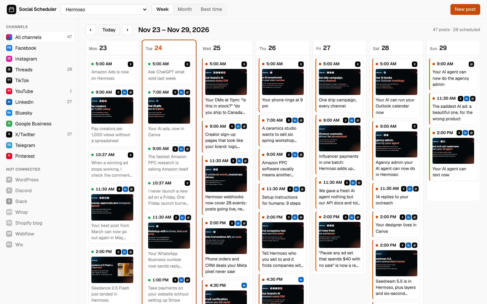
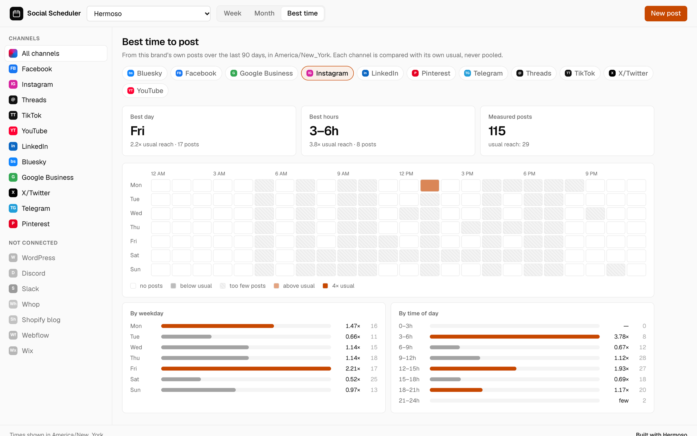
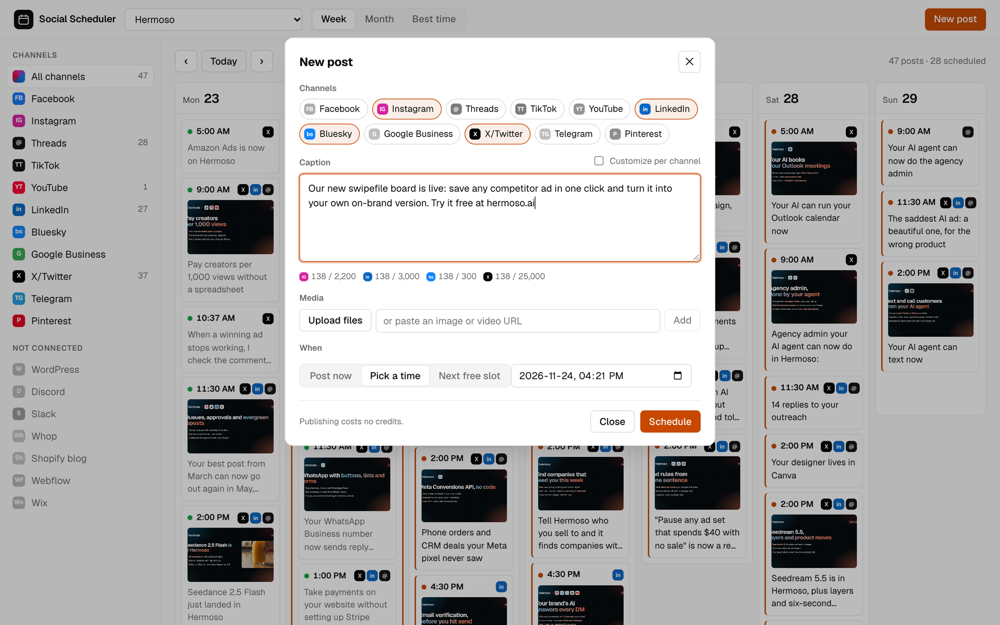

# Social Scheduler

An open-source social media scheduler: a calendar, best time to post and a composer for Instagram, TikTok, LinkedIn,
X, YouTube, Facebook, Threads, Pinterest, Bluesky and more, built on the [Hermoso](https://hermoso.ai/?utm_source=github&utm_medium=oss&utm_campaign=social-scheduler) API.

[](https://vercel.com/new/clone?repository-url=https%3A%2F%2Fgithub.com%2Fhermoso-ai%2Fsocial-scheduler&env=HERMOSO_API_KEY&envDescription=Your%20Hermoso%20API%20key&envLink=https%3A%2F%2Fapp.hermoso.ai)
[](https://app.netlify.com/start/deploy?repository=https://github.com/hermoso-ai/social-scheduler)



*A real week of the Hermoso brand's own posts, read live from the API.*

## What it does

- **Calendar.** Week and month views of every scheduled and published post. Filter to one channel from the rail.
- **Post detail.** The caption and any per-channel caption, the media, and for a post that has gone out, a link to it
  on each channel or the reason a channel refused it.
- **Composer.** Pick channels, write once or customise per channel, and see each channel's character limit as you
  type. Upload images and videos or paste a link. Post now, pick a time, or take the next free slot in your schedule.
  Edit, reschedule or cancel anything still scheduled.
- **Best time to post.** A day-by-hour heatmap per channel from your own posts' performance, each channel against its
  own usual, with the best day and best hours when one clearly stands out.
- **Brands.** If your account runs several brands (an agency, say), switch between them from the top bar.

| Best time to post | Composer |
|---|---|
|  |  |

## Quickstart

1. Get an API key: sign in at [app.hermoso.ai](https://app.hermoso.ai), open the **API, MCP & CLI** tab and create a
   key under **Terminal & API keys**. New accounts start free.
2. Connect the channels you want to post to in [app.hermoso.ai](https://app.hermoso.ai). Each one is a
   one-time sign-in with that network.
3. Run it:

```bash
git clone https://github.com/hermoso-ai/social-scheduler.git
cd social-scheduler
cp .env.example .env.local   # paste your key into HERMOSO_API_KEY
npm install
npm run dev                  # http://localhost:3000
```

| Variable | |
|---|---|
| `HERMOSO_API_KEY` | Required. Stays on the server; the browser only ever talks to this app's own routes. |
| `HERMOSO_BRAND` | Optional. The brand to open on, an `id` from `GET /v1/brands`. |
| `APP_PASSWORD` | Optional, and recommended for any deployed copy: anyone who can open the app can post with your key. When set, the app asks for it (any username). |

## How it works

A Next.js 15 app. Every call to Hermoso happens in a route handler under [`app/api`](app/api), through the official
TypeScript SDK, [`@hermoso/sdk`](https://www.npmjs.com/package/@hermoso/sdk):

| Feature | Endpoint | SDK |
|---|---|---|
| Channels and whether each is connected | `GET /v1/channels` | `listChannels` |
| Calendar | `GET /v1/posts` (cursor-paginated) | `listPosts` |
| Post detail and per-channel results | `GET /v1/posts/{id}` | `getPost` |
| Post now or schedule | `POST /v1/posts` with an `Idempotency-Key` | `createPost` |
| Edit or reschedule | `PATCH /v1/posts/{id}` | `updatePost` |
| Cancel a scheduled post | `DELETE /v1/posts/{id}` | `deletePost` |
| Upload media or import it from a link | `POST /v1/media` | `createMedia` |
| Best time to post | `GET /v1/analytics/best-time` | `getBestTime` |
| Brand switcher | `GET /v1/brands` | `listBrands` |

```ts
import { createHermosoClient, createPost } from '@hermoso/sdk';

const hermoso = createHermosoClient(); // reads HERMOSO_API_KEY
const { data: post, error } = await createPost({
  client: hermoso,
  body: { channels: ['instagram', 'linkedin'], caption: 'Hello', media: [imageUrl], scheduled_at: '2026-12-01T15:00:00Z' },
  headers: { 'Idempotency-Key': crypto.randomUUID() },
});
```

Each composed post carries one idempotency key, so a retry after a dropped connection can never post twice. The API
checks everything it can refuse (a caption over a channel's limit, a carousel a channel cannot carry) when you
schedule, not when the post goes out, and the composer shows that error as it is.

Publishing and scheduling cost no credits. Hermoso can also make the posts themselves (image and video ads on your
brand) through the same API: see the [API docs](https://hermoso.ai/docs/api/).

## Built with Hermoso

[Hermoso](https://hermoso.ai/?utm_source=github&utm_medium=oss&utm_campaign=social-scheduler) researches the ads that
work in your market, makes finished image and video ads for your brand, and publishes and schedules them to your own
channels and ad accounts, from the web app, an AI agent over MCP, the CLI or this API.
[API docs](https://hermoso.ai/docs/api/) · [SDKs](https://hermoso.ai/docs/sdks/)

More open-source apps on the Hermoso API: [ad-spy](https://github.com/hermoso-ai/ad-spy) ·
[brand-to-ads](https://github.com/hermoso-ai/brand-to-ads)

## License

MIT. See [LICENSE](LICENSE).
